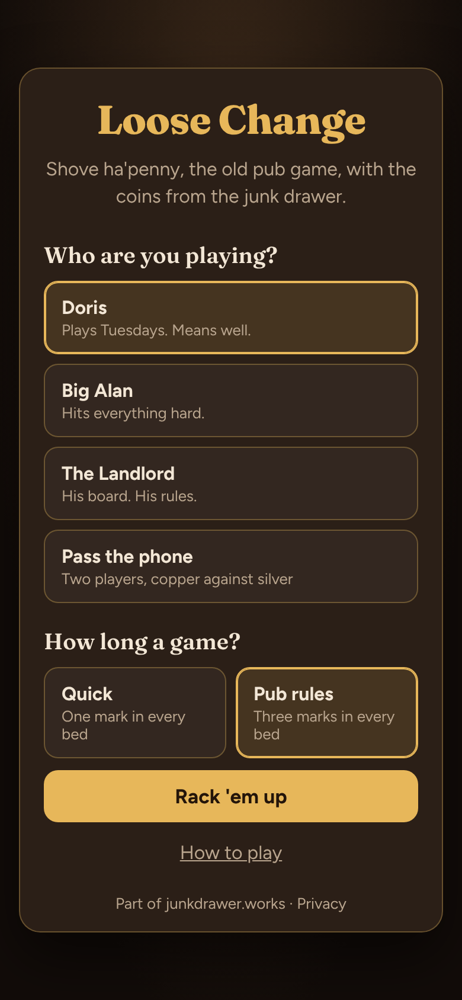
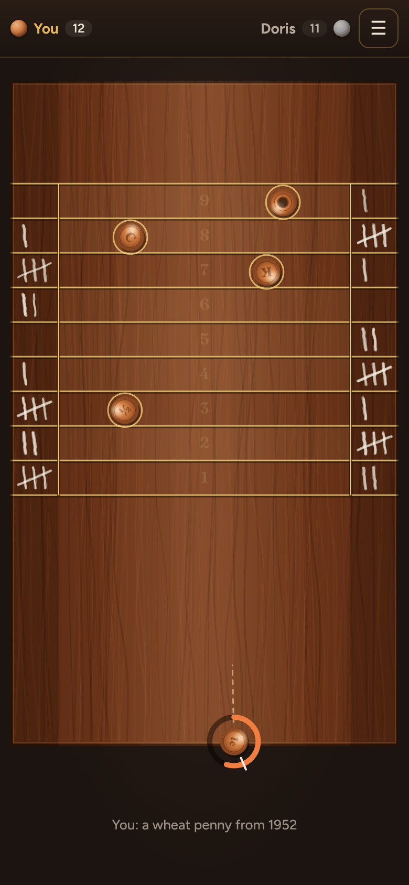
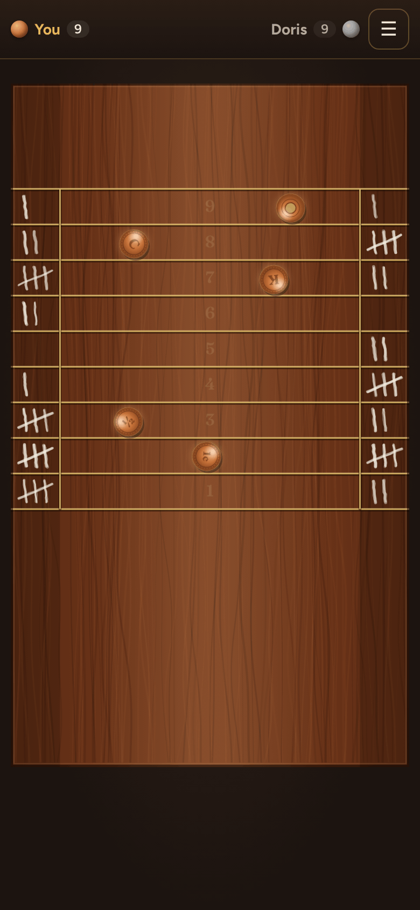

# Loose Change

**Play it: [loose-change.junkdrawer.works](https://loose-change.junkdrawer.works/)**

**Shove ha'penny, the old pub game, played on your phone with the coins from the junk drawer.** You put a coin on the near edge of a mahogany board, pull back and let go, and it slides up into nine beds between brass lines. Land coins cleanly in the beds to chalk up marks, fill every bed before the other side does, and play the pub regulars, pass the phone to a friend, or go for your best on your own.

<p align="center">
  
  &nbsp;
  
  &nbsp;
  
</p>

## How it plays

- **Place it, then shove it.** Slide your finger sideways to move the coin along the near edge, then pull back and let go. The further you pull, the harder the shove, and pulling to one side angles it. On a keyboard, the arrow keys move the coin and holding space builds up the shove.
- **Five coins a turn.** Each one slides, slows on the wood and clinks into the coins already up there, so a later coin can knock an earlier one into a bed (or out of it).
- **The beds and the brass lines.** A coin lying wholly inside one of the nine beds, not touching a brass line or past the side lines, scores a chalk mark in that bed when your five coins are done.
- **Short coins come back.** A coin that doesn't reach the first line is picked up and played again.
- **Coins off the edge are gone.** One that slides off the side or the far end is lost for the turn.
- **Chalk marks and full beds.** You chalk up on your side of the board, the other player on theirs. Once one of your beds is full, any more coins in it chalk up for your opponent instead, except their winning mark: that one they have to score themselves.
- **Quick or pub rules.** A quick game needs one mark in every bed; pub rules need three in every bed. The first to fill all nine wins.
- **The regulars.** Doris, Big Alan and The Landlord each try out shots on a copy of the board (forty for Doris, a couple of hundred for The Landlord), keep the one that leaves them best placed, then play it with their own unsteady hand. The Landlord also checks which of his best shots still work when his hand wobbles.
- **Pass the phone.** Two people on one phone: copper against silver.
- **On your own.** No opponent: fill every bed in as few turns as you can, and it keeps your best for each length of game.
- **Hold to hurry.** Keep a finger on the board while the computer plays and its turn runs three times as fast. The menu pauses the game.
- **Loose change.** Every coin is something from the drawer: a ha'penny from 1967, a wheat penny, a skee-ball token, a brass washer, a bus token from 1987.
- **Sounds made with Web Audio.** The slide, the clink and the chalk are made on the spot, with no sound files. They can be turned off from the menu.
- No account and no server. Your settings, your record against each regular, your best on your own and a game in progress stay in your browser. It works offline and installs to a phone's home screen.

## Running it

It's a static site: plain HTML, CSS and JavaScript modules, with no build step.

```sh
npx http-server -p 8080 -c-1 .   # or any static file server, then open http://localhost:8080
npm install                      # only for the tools below
npm test                         # unit tests for the physics and scoring, then plays it in Chromium (needs Playwright)
node tools/screenshots.mjs       # redraws docs/*.png and og.png
node tools/make-icons.mjs        # redraws the PNG icons from icon.svg
npm run build                    # writes dist/artifact.html, the whole game in one file
```

Opening `index.html` straight from disk won't work, because browsers block JavaScript modules on `file://`.

To put it online with GitHub Pages: **Settings → Pages → Build and deployment → Deploy from a branch**, then pick `main` and `/ (root)`. The `CNAME` file serves it at its own address, loose-change.junkdrawer.works.

### Files

- `index.html`: the page, with the title, menu, rules and game-over sheets.
- `css/app.css`: the pub palette and layout.
- `js/app.js`: the game: turns, aiming by touch and keyboard, chalking up, saving a game in progress.
- `js/physics.js`: the board in millimetres (a 24 by 14 inch pub board, nine 1¼ inch beds), sliding friction, coin-on-coin knocks and which bed a coin lies in.
- `js/rules.js`: the scoring: marks per bed, full beds giving marks away, and the winning mark.
- `js/ai.js`: Doris, Big Alan and The Landlord, who simulate shots on a copy of the board and play the best one with a wobble.
- `js/render.js`: draws the wood, the brass lines, the coins and the chalk on a canvas.
- `js/sound.js`: the sounds, made with Web Audio.
- `fonts/`: Fraunces and Figtree (SIL Open Font License), served from here so nothing loads from elsewhere.
- `sw.js`: keeps a copy for playing offline.
- `manifest.webmanifest`, `icon.svg`, `icon-*.png`: for installing it to a home screen.
- `tools/`: the screenshot and icon scripts above. `scripts/build.mjs`: the single-file build.
- `test/`: unit tests and a run through the real page in Chromium.
